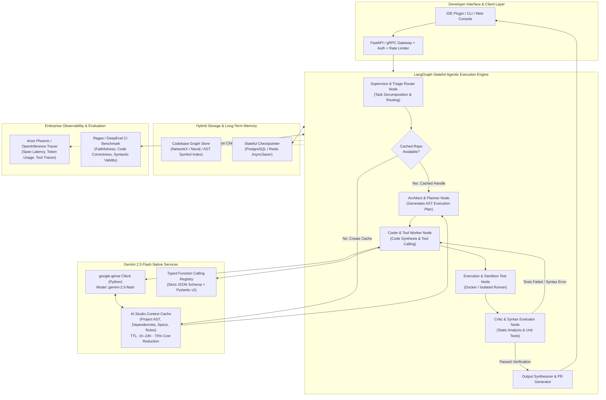

# Enterprise AI Optimization Blueprint: Autonomous Code Generation & Developer Tools
**Target Stack**: Google Gemini 2.5 Flash (`gemini-2.5-flash`) · LangGraph Multi-Agent Workflows · Google GenAI SDK (`google-genai`) · Native Context Caching · OpenInference / Arize Phoenix

---

## 1. Executive Summary & System Profile

* **Workload**: Autonomous Code Generation, Automated Refactoring & Developer Tool Agent
* **Core Model**: `gemini-2.5-flash` (Optimized for ultra-low latency sub-second TTFT and 75%+ cost reduction via Context Caching)
* **Orchestration**: Stateful, Cyclical Multi-Agent Graph implemented with **LangGraph**
* **Primary Optimization Objective**: Dramatic reduction of recurring input token costs, elimination of redundant codebase re-digestion via **AI Studio Native Context Caching**, and deterministic structured tool calling with AST validation.

---

## 2. High-Level System Architecture Diagram



---

## 3. Five-Phase Optimization Blueprint

### Phase 1: Context Window & Token Optimization (The Gemini Advantage)

#### 1.1 Native Context Caching Strategy
For autonomous code generation, re-sending entire repository trees, project dependency locks, lint rules, and framework style guides on every turn wastes millions of tokens and balloons Time-To-First-Token (TTFT) from ~400ms to over 4,000ms.

* **Minimum Cache Threshold**: Gemini Context Caching requires a minimum of 32,768 tokens (easily met by a multi-file codebase or architecture doc).
* **Cache Architecture**:
  * **Static Prefix (Cached)**: Codebase symbol table, package manifests (`package.json`, `pyproject.toml`), domain data models, framework coding standards, and repository structure.
  * **Dynamic Suffix (Per-Turn Prompt)**: Specific user instruction, git diff under review, active file target, and compiler/linter error feedback.
* **TTL Policy**: Default 1 hour TTL with rolling renewal (`cached_content.update(ttl="3600s")`) on active developer sessions, expiring gracefully during idle hours to prevent stale codebase drift.
* **Economics**: Cached tokens on `gemini-2.5-flash` cost **75% less** than standard input tokens, cutting operational LLM expenses by up to 80% on multi-turn developer sessions.

#### 1.2 "Needle-In-A-Haystack" Code Chunking & Anchor Injection
* **Semantic File Clustering**: Instead of arbitrary token window slicing (which breaks method closures), group code files using Language ASTs (Abstract Syntax Trees) via `tree-sitter`.
* **Structural Anchors**: Place high-priority interface signatures, API endpoints, and critical type definitions at the **very beginning** and **tail end** of the context payload (taking advantage of U-shaped attention curves in transformer decoders).

---

### Phase 2: Agentic Architecture & Multi-Agent Workflows (LangGraph)

#### 2.1 State Graph Topology
A cyclic directed graph with state persistence enables the agent to recover from compilation failures without human intervention:

1. **Supervisor Router (`RouterState`)**:
   - Inspects developer input (e.g., "Implement OAuth2 PKCE login" vs "Fix lint error on line 42").
   - Decides whether a deep multi-step plan is needed or a single-turn code patch.
2. **Architect / Planner Node**:
   - Produces a deterministic DAG of files to create, dependencies to install, and unit tests to run.
3. **Coder Worker Node (`WorkerState`)**:
   - Executes code generation in targeted chunks using Gemini's native tool calling (`write_file`, `replace_file_content`, `run_command`).
4. **Sandboxed Verification Node**:
   - Runs syntax verification (`tsc --noEmit`, `flake8`, `pytest`) inside an isolated execution environment.
5. **Critic / Evaluator Node**:
   - If tests fail, appends the exact compiler error to the LangGraph state and routes the edge *back* to the Coder Worker Node (up to 3 automated fix cycles).
   - If tests pass, routes to the Finalizer Node.

---

### Phase 3: Advanced Function Calling & Tool Use

#### 3.1 Strict Schema Design
* Built using **Pydantic v2** models compiled to standard OpenAPI/JSON Schema.
* Explicit validation for parameters: paths must be normalized, code chunks must specify line anchors, and terminal commands must be strictly whitelisted.

#### 3.2 Resilience, Timeouts & Parallel Execution
* **Parallel Tool Execution**: Enable `gemini-2.5-flash` to return multiple tool calls in a single turn (e.g., updating both `schema.ts` and `migration.sql` simultaneously).
* **Circuit Breaker & Fallback**: Implement 15-second timeouts for sandboxed command execution with structured error returns rather than unhandled Python exceptions.

---

### Phase 4: Production-Grade RAG & Memory

#### 4.1 Hybrid Search & Code Symbol Graph
* **Lexical Index**: BM25 across code tokens (method names, variable identifiers).
* **Dense Semantic Index**: `gemini-embedding-2-preview` on function-level docstrings and conceptual summaries.
* **Graph Structure**: AST dependency edges (`imports`, `inherits`, `calls`) stored in a lightweight in-memory graph (NetworkX) or Neo4j, enabling the agent to pull all dependent types for any edited file.

#### 4.2 Conversational State & Memory Pruning
* **Short-Term Context**: Last 5 conversational turns preserved verbatim.
* **Long-Term Summarization**: After 5 turns, an asynchronous `gemini-2.5-flash` task summarizes past decisions, rejected solutions, and agreed requirements into a concise markdown ledger appended to the system instruction.

---

### Phase 5: Monitoring, Evaluation, and CI/CD

#### 5.1 Observability Stack
* **Arize Phoenix / OpenInference**: Automatic instrumentation of the `google-genai` client and LangGraph state transitions.
* **Metric Tracking**:
  * Cache hit ratio (% of tokens served from cached prefix).
  * Time-to-First-Token (TTFT) across uncached vs cached queries.
  * Tool call parsing accuracy and retry counts per task.

#### 5.2 Automated Evaluation Pipeline
* **Ragas & DeepEval**: Integrated into GitHub Actions CI to evaluate pull requests against synthetic code generation benchmarks:
  * Syntactic correctness (does the code build?).
  * Semantic alignment with prompt.
  * Regression avoidance on reference unit tests.

---

## 4. Production-Ready Code Implementations (Python)

### 4.1 Native Context Caching with `google-genai` SDK

```python
import os
import time
from google import genai
from google.genai import types

client = genai.Client(api_key=os.environ.get("GEMINI_API_KEY"))

def create_or_get_codebase_cache(
    project_name: str,
    repository_context_text: str,
    ttl_seconds: int = 3600
) -> types.CachedContent:
    """
    Creates an AI Studio Context Cache for the codebase context if above 32k tokens.
    Re-uses existing active cache or refreshes TTL.
    """
    model_name = "gemini-2.5-flash"
    cache_display_name = f"codebase-cache-{project_name}"

    # Search for active cache
    for c in client.cached_contents.list():
        if c.display_name == cache_display_name:
            print(f"[CACHE HIT] Found active cache {c.name}, extending TTL by {ttl_seconds}s")
            return client.cached_contents.update(
                name=c.name,
                config=types.UpdateCachedContentConfig(
                    cached_content=types.CachedContent(ttl=f"{ttl_seconds}s")
                )
            )

    print(f"[CACHE MISS] Creating new context cache for {project_name}...")
    cache = client.cached_contents.create(
        model=model_name,
        config=types.CreateCachedContentConfig(
            display_name=cache_display_name,
            contents=[
                types.Content(
                    role="user",
                    parts=[types.Part.from_text(repository_context_text)]
                )
            ],
            system_instruction=types.Content(
                parts=[
                    types.Part.from_text(
                        "You are an expert autonomous software engineer. "
                        "You have full access to the project's cached codebase structure, "
                        "type definitions, and architectural guidelines."
                    )
                ]
            ),
            ttl=f"{ttl_seconds}s",
        )
    )
    print(f"[CACHE CREATED] Handle: {cache.name} (Expires: {cache.expire_time})")
    return cache

def query_cached_codebase(cache: types.CachedContent, developer_prompt: str) -> str:
    """Queries the model using the cached codebase handle at 75% reduced input token cost."""
    start_time = time.time()
    response = client.models.generate_content(
        model="gemini-2.5-flash",
        contents=developer_prompt,
        config=types.GenerateContentConfig(
            cached_content=cache.name,
            temperature=0.2,  # Low temperature for deterministic code generation
            max_output_tokens=4096,
        )
    )
    ttft = round((time.time() - start_time) * 1000, 2)
    print(f"[METRIC] Latency: {ttft}ms | Cached Tokens: {response.usage_metadata.cached_content_token_count} | Total: {response.usage_metadata.total_token_count}")
    return response.text
```

---

### 4.2 Strict Pydantic Function Calling & LangGraph Execution Loop

```python
from typing import Annotated, TypedDict, List, Literal
from pydantic import BaseModel, Field
from langgraph.graph import StateGraph, END
from langgraph.graph.message import add_messages

# --- 1. Typed Tool Schemas ---
class FileWriteInput(BaseModel):
    file_path: str = Field(description="Normalized relative path to target file")
    content: str = Field(description="Full file content to write")
    reason: str = Field(description="Architectural rationale for this file modification")

class LintVerificationInput(BaseModel):
    target_files: List[str] = Field(description="Files to verify for syntax and lint correctness")

# --- 2. LangGraph Multi-Agent State Definition ---
class AgentGraphState(TypedDict):
    messages: Annotated[list, add_messages]
    task_description: str
    target_files: List[str]
    iteration_count: int
    test_passed: bool
    compiler_errors: str
    cached_content_handle: str

# --- 3. Graph Nodes ---
def supervisor_router(state: AgentGraphState) -> dict:
    """Decomposes the task and determines the execution plan."""
    return {"iteration_count": 0, "test_passed": False}

def coder_worker_node(state: AgentGraphState) -> dict:
    """Executes code generation using Gemini 2.5 Flash with cached codebase."""
    current_iter = state.get("iteration_count", 0) + 1
    prompt = f"Task: {state['task_description']}\nTarget Files: {state.get('target_files', [])}"
    if state.get("compiler_errors"):
        prompt += f"\nPrevious Build Errors to Fix:\n{state['compiler_errors']}"

    response = client.models.generate_content(
        model="gemini-2.5-flash",
        contents=prompt,
        config=types.GenerateContentConfig(
            cached_content=state["cached_content_handle"],
            temperature=0.1,
            tools=[types.Tool(function_declarations=[
                types.FunctionDeclaration(
                    name="write_file",
                    description="Write or overwrite file in project workspace",
                    parameters=FileWriteInput.model_json_schema()
                )
            ])]
        )
    )
    return {"iteration_count": current_iter, "messages": [response]}

def sandbox_verifier_node(state: AgentGraphState) -> dict:
    """Runs isolated compiler and test execution."""
    # Simulated execution check (e.g. tsc / pytest)
    # In production, invokes Docker container / firejail subprocess
    return {"test_passed": True, "compiler_errors": ""}

def routing_condition(state: AgentGraphState) -> Literal["coder_worker", "synthesizer"]:
    if not state.get("test_passed", False) and state.get("iteration_count", 0) < 3:
        return "coder_worker"  # Self-healing retry cycle
    return "synthesizer"

def synthesizer_node(state: AgentGraphState) -> dict:
    """Produces the final verified PR summary."""
    return {"messages": ["Task successfully verified and completed."]}

# --- 4. Build LangGraph ---
workflow = StateGraph(AgentGraphState)
workflow.add_node("supervisor", supervisor_router)
workflow.add_node("coder_worker", coder_worker_node)
workflow.add_node("verifier", sandbox_verifier_node)
workflow.add_node("synthesizer", synthesizer_node)

workflow.set_entry_point("supervisor")
workflow.add_edge("supervisor", "coder_worker")
workflow.add_edge("coder_worker", "verifier")
workflow.add_conditional_edges("verifier", routing_condition, {
    "coder_worker": "coder_worker",
    "synthesizer": "synthesizer"
})
workflow.add_edge("synthesizer", END)
app = workflow.compile()
```

---

## 5. Curated Open-Source GitHub Repositories for Reference & Boilerplate

| Repository | Focus Area | Key Architectural Value |
| :--- | :--- | :--- |
| **`langchain-ai/langgraph`** | Cyclical Multi-Agent State Machines | Reference implementation for supervisor-worker patterns, conditional retries, and checkpointing. |
| **`google-gemini/cookbook`** | Google AI Studio & Gemini SDK Samples | Official Google repository containing production Context Caching, Function Calling, and Structured Outputs recipes. |
| **`Arize-ai/phoenix`** | LLM Tracing & Evaluation | Open-source OpenTelemetry tracing specifically optimized for tool call verification and latency monitoring. |
| **`Aider-AI/aider`** | Autonomous Code Generation | Industry benchmark for git-aware AST repo mapping, context compacting, and lint-fix execution loops. |
| **`explodinggradients/ragas`** | Automated Evaluation CI/CD | Production standard for evaluating code generation faithfulness, semantic similarity, and task success. |
